# Сетевые протоколы

Кроссплатформенное мобильное приложение на **Flutter** — справочник по основным сетевым протоколам
(HTTP/HTTPS, TCP/IP, UDP, FTP, DNS). Проект выполнен в рамках практических работ по дисциплине
«Проектирование и разработка кроссплатформенных мобильных приложений».

<p align="center">
  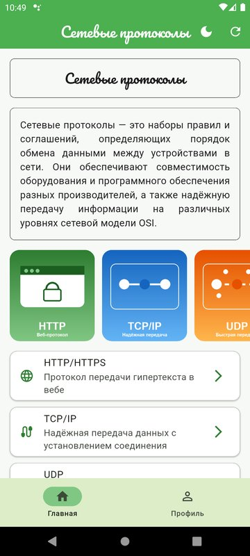
  &nbsp;&nbsp;
  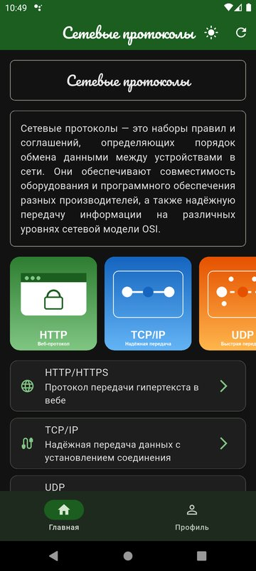
</p>

## Возможности

- экран заставки с автоматическим переходом к авторизации;
- авторизация и регистрация с валидацией полей (регулярные выражения) и переходом фокуса между полями;
- основной экран со списком протоколов, нижней панелью навигации и адаптивной вёрсткой
  (при ширине экрана более 600 — карточки в 2 столбца);
- экран детализации протокола и экран профиля пользователя;
- управление состоянием основного экрана с помощью **BLoC** (состояния initial, loading, loaded, error);
- локальная база данных **Drift (SQLite)**, паттерн **Repository** с CRUD-операциями;
- внедрение зависимостей через **GetIt + Injectable**;
- светлая и тёмная темы с переключением через **Cubit** (кнопка в AppBar и переключатель в профиле).

## Скриншоты

### Заставка, авторизация и регистрация

<p align="center">
  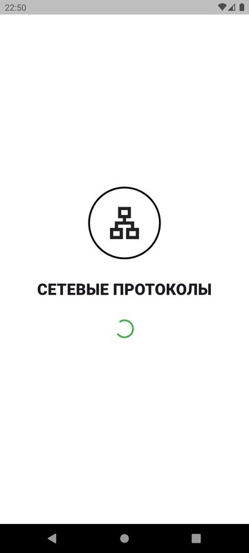
  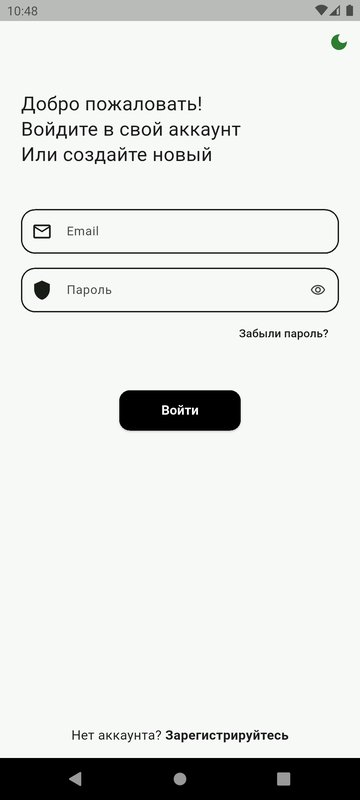
  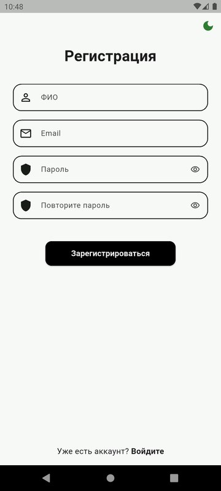
  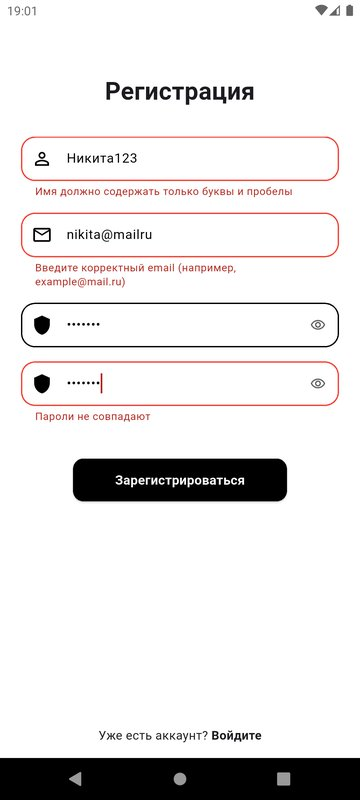
</p>

### Основной экран и детализация

<p align="center">
  
  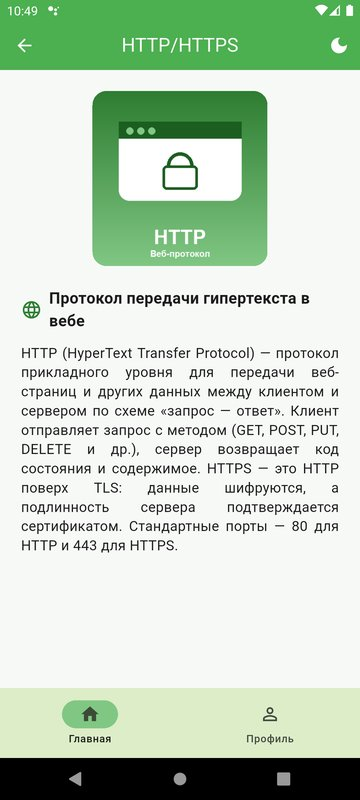
  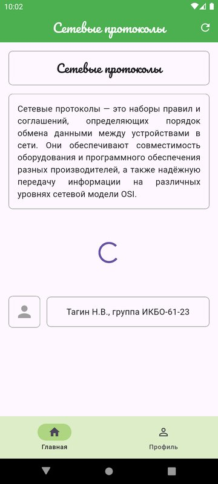
  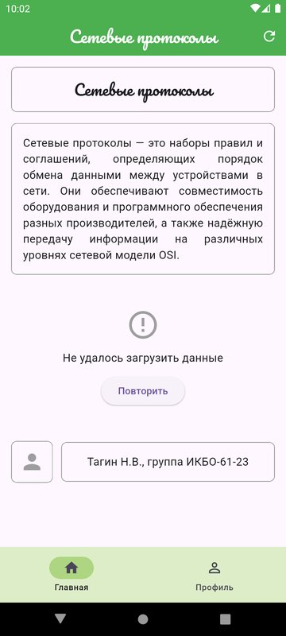
</p>

### Адаптивная вёрстка (ширина более 600)

<p align="center">
  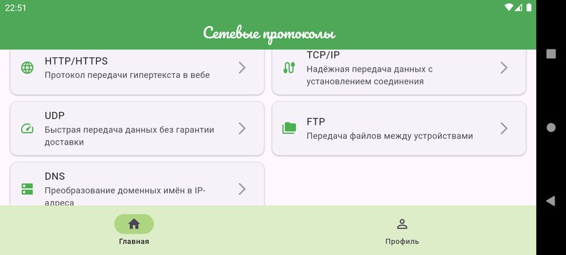
</p>

### Светлая и тёмная темы

| Светлая | Тёмная | Светлая | Тёмная |
|:---:|:---:|:---:|:---:|
|  | 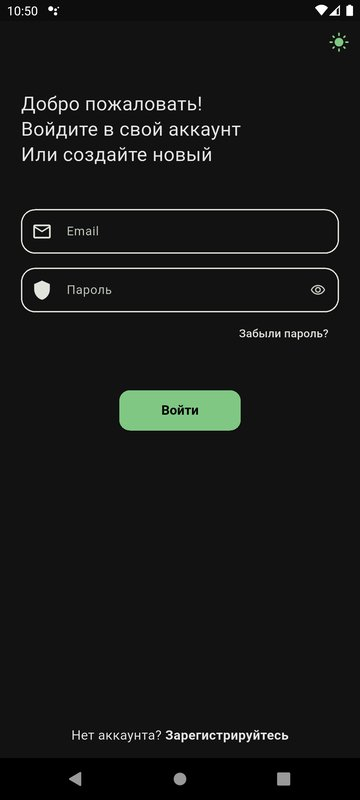 |  | 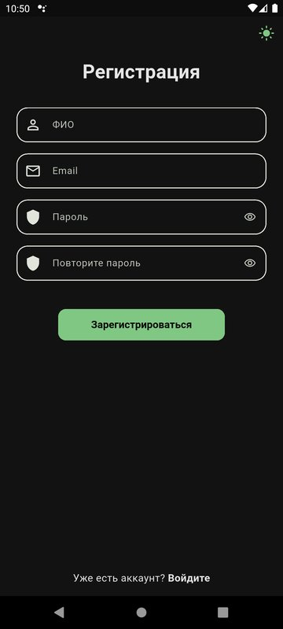 |
|  | 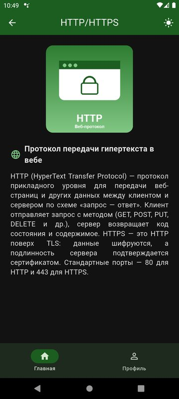 | 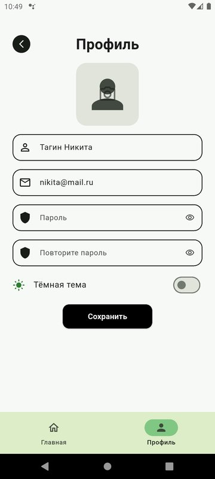 | 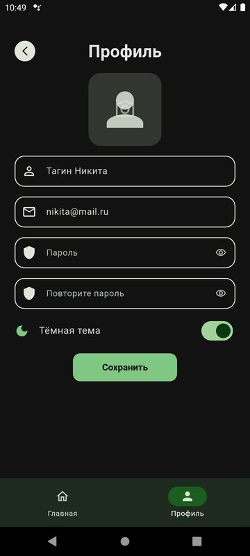 |

## Технологии

| Задача | Решение |
|---|---|
| UI | Flutter, Material 3 |
| Управление состоянием | `flutter_bloc` (Bloc, Cubit) |
| Локальная БД | `drift`, `drift_flutter` (SQLite) |
| Внедрение зависимостей | `get_it`, `injectable` |
| Кодогенерация | `build_runner`, `drift_dev`, `injectable_generator` |
| Навигация | Navigator, именованные маршруты |

## Архитектура

```
lib/
├── data/                       # слой данных
│   ├── protocol_database.dart  # таблица Drift, миграции, начальное заполнение
│   ├── protocols_repository.dart  # Repository (CRUD)
│   └── protocols_seed.dart     # начальные данные БД
├── di/                         # DI-контейнер (GetIt + Injectable)
├── models/                     # модель Protocol
├── pages/                      # слой представления
│   ├── home/                   # основной экран
│   │   ├── bloc/               # HomeBloc: события, состояния, логика
│   │   └── home_page.dart
│   ├── detail_page.dart
│   ├── loading_page.dart
│   ├── login_page.dart
│   ├── register_page.dart
│   └── profile_page.dart
├── theme/                      # темы оформления и ThemeCubit
├── widgets/                    # общие виджеты (поле ввода, кнопка)
├── main.dart                   # точка входа, маршруты, подключение тем
└── routes.dart                 # имена маршрутов
```

Поток данных основного экрана: **UI → событие → HomeBloc → ProtocolsRepository → Drift (SQLite)**,
обратно — новое состояние блока, по которому `BlocBuilder` перестраивает экран.

## Запуск

```bash
flutter pub get
dart run build_runner build --delete-conflicting-outputs   # при изменении таблиц или аннотаций DI
flutter run
```

Для входа подойдут, например, email `nikita@mail.ru` и пароль `abc_123`
(пароль: не менее 6 символов, буквы, цифры и один из символов `+ _ -`).

## Тесты

```bash
flutter test
```

Тесты проверяют валидацию форм и навигацию, переход фокуса, адаптивную вёрстку, работу HomeBloc,
CRUD-операции репозитория на базе Drift в памяти, регистрацию зависимостей в DI и переключение тем.

## Автор

Тагин Н.В., группа ИКБО-61-23, РТУ МИРЭА
